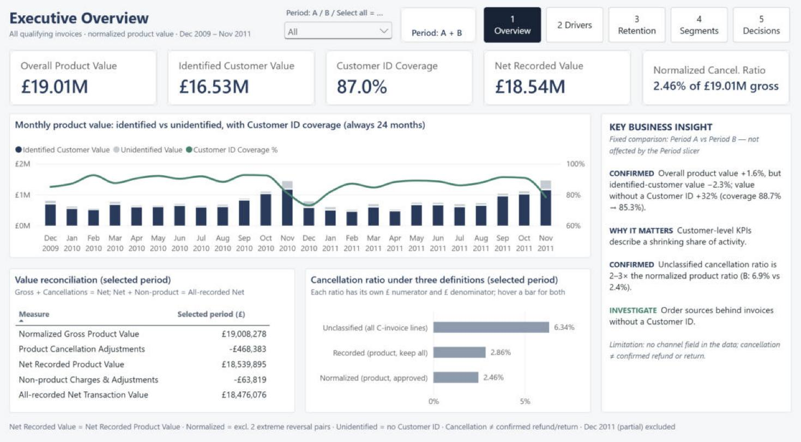
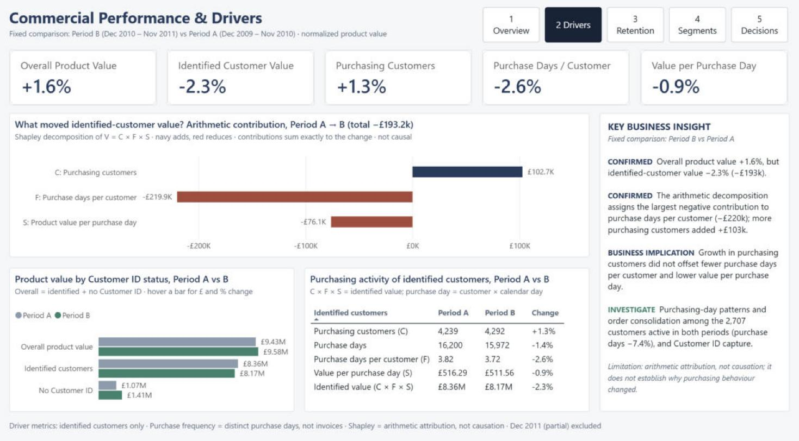
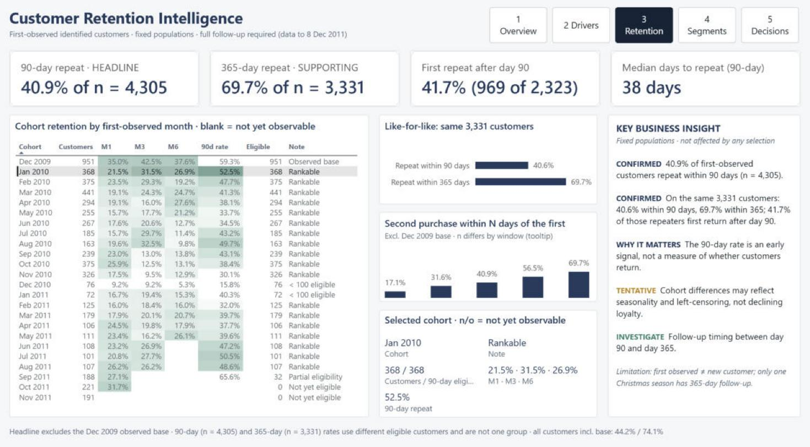
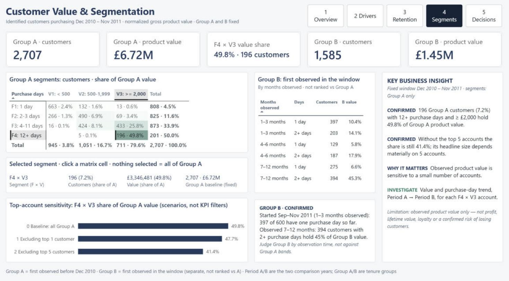
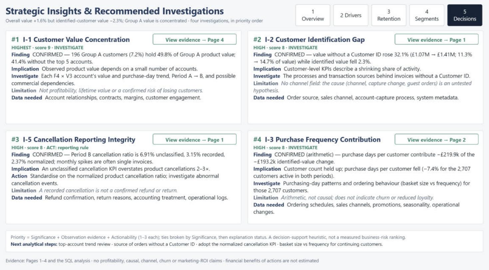

# E-commerce Customer Retention & Revenue Quality Intelligence

**An SQL (DuckDB) and Power BI analysis of the UCI Online Retail II dataset: a UK online wholesale and gift retailer, December 2009 – December 2011.**

## TL;DR

> **Problem:** recorded sales grew 1.6% year on year. Can management trust that headline, and what is behind it?
>
> **Finding:** the growth came from transactions **without a Customer ID** (+32.1%), while value from identified customers **fell 2.3%**. Customer-level KPIs therefore describe a shrinking share of the business. Value is also concentrated: 7.2% of returning customers hold 49.8% of their group's value.
>
> **Recommendation:** investigate where the unidentified transactions come from, review the top-value accounts, and standardise on one cancellation KPI (the unclassified version overstates cancellations 2–3×).
>
> **How:** DuckDB SQL pipeline over 1,067,371 rows → 5-page Power BI dashboard · 145 SQL checks + 137 DAX checks pass · 53/53 KPIs reconcile to SQL.

📄 **[View the dashboard as a PDF](docs/Dashboard_Preview.pdf)** (no Power BI needed) · ⬇ [Download the .pbix](powerbi/Online_Retail_II_Retention_Revenue_Quality.pbix) · [Findings](docs/findings_and_recommendations.md) · [Methodology](docs/methodology.md)



## Project overview

- **Goal:** test whether a small headline sales increase can be trusted, explain what drove the change, and identify which customers return and which hold the value.
- **Deliverables:**
  - A five-page interactive Power BI dashboard, downloadable as a PBIX with the data already imported.
  - The SQL pipeline behind it, with 145 automated SQL checks and 137 DAX validation checks.
  - Four prioritised business investigations.
- **Download:** [`powerbi/Online_Retail_II_Retention_Revenue_Quality.pbix`](powerbi/Online_Retail_II_Retention_Revenue_Quality.pbix) (2.3 MB). See [How to download and explore](#how-to-download-and-explore).

## Business problem

Recorded sales grew slightly between the two trading years. Before management acts on that headline, it needs to know:

- **how reliable the recorded value is** once cancellations, fees and adjustments are separated;
- **what drove the change:** more customers, more frequent purchasing, or larger purchases;
- **which customers return and who holds the value**, so that the next commercial investigations are well chosen.

## Business questions

| # | Question |
|---|---|
| BQ1 | **Data reliability:** how reliable is recorded product value after cancellations and adjustments? |
| BQ2 | **Commercial performance:** what drove the change between Period A (Dec 2009 – Nov 2010) and Period B (Dec 2010 – Nov 2011)? |
| BQ3 | **Customer retention:** how consistently do identified customers return, and how does repeat purchasing differ across cohorts? |
| BQ4 | **Customer value and segmentation:** which customer groups hold the most observed product value (Dec 2010 – Nov 2011)? |
| BQ5 | **Investigation priorities:** which groups or patterns deserve further commercial investigation? |

## Dataset and scope

- **Source:** *Online Retail II*, UCI Machine Learning Repository, dataset #502 ([attribution](#data-attribution-and-licensing)).
- **Size:** two worksheets, 1,067,371 rows, 1 Dec 2009 – 9 Dec 2011.
- **Periods:**
  - Two aligned 12-month periods: A and B.
  - Dec 2011 covers only 9 days. It is excluded from period KPIs and kept for reconciliation and retention follow-up.
- **Value measure:** *normalized gross positive product value*. This is product purchase value; it is **not** revenue or profit, because the data has no cost, tax or refund information.
- **Customer ID:** 22.5% of lines (13.2% of product value) have no Customer ID.
  - They are kept for value reporting.
  - Customer metrics cover identified customers only.

## Data preparation and SQL approach

```
UCI Excel ──► DuckDB staging ──► model (invoice · customer × day · customer)
          ──► KPI & analysis views ──► automated checks ──► Parquet export ──► Power BI (import)
```

- **Combining the sheets:** the worksheets overlap on 1–9 Dec 2010. Those 1,088 invoices are counted once, which leaves 1,044,848 lines. The raw file is never modified.
- **Classification:** every line is assigned to one business class, with 0 lines unclassified:
  - product purchase and product cancellation;
  - shipping, fee, manual adjustment, discount, bad debt, sample, voucher, test;
  - zero-price.
- **Flag, never delete:**
  - 22,813 duplicate-candidate rows are kept.
  - Two "keying error" pairs (a purchase of 10,000+ units reversed within minutes) are flagged. Each nets to £0. They are excluded from normalized value and kept for reconciliation.
- **SQL files (`sql/`):**
  - `01`–`04`: staging, model, KPI views, 60 checks.
  - `10`–`14`: one analysis file per business question, 24 checks.
  - `20`–`22`: the Power BI shaping layer, 39 export checks and 22 Parquet read-back checks.
- **Methods:**
  - Value bridge.
  - Three cancellation-ratio definitions.
  - A Shapley decomposition of identified value V = customers × purchase days per customer × value per purchase day.
  - Fixed-window repeat rates with full follow-up only.
  - Cohort retention.
  - A frequency × value segmentation, with a top-account sensitivity test.

Definitions are in [`docs/methodology.md`](docs/methodology.md).

## Data model and Power BI

- **Star schema:**
  - A month dimension, which is the only slicer date table.
  - Two fact tables: invoice, and customer × purchase day.
  - A customer dimension with surrogate keys.
- **Model rules:**
  - Single-direction relationships; no fact-to-fact or many-to-many links.
  - Results computed in SQL (cohorts, Shapley, sensitivity) sit in disconnected reference tables, so a slicer cannot change a validated denominator.
- **Measures:** 129 DAX measures, kept simple: sums, ratios, fixed-period comparisons, display text and validation helpers.

| Page | Question it answers | Interaction |
|---|---|---|
| 1 Executive Overview | Can we trust the numbers, and what is the headline? | Period slicer (A / B / A + B); the 24-month trend stays fixed; value reconciliation |
| 2 Commercial Drivers | Which lever moved identified-customer value? | Tooltips with £ and % change, A → B |
| 3 Customer Retention | Do customers come back, and how quickly? | **Cohort Explorer:** click a cohort row to see its profile and eligibility |
| 4 Value & Segmentation | Who holds the value, and how robust is that? | **Segment Explorer:** click a matrix cell; the Group A baseline stays fixed |
| 5 Decision Brief | What should management investigate first? | **Evidence navigation:** each card links to its supporting page |

A hidden *Data Notes & Reconciliation* page lists the definitions and compares 53 dashboard KPIs with their SQL targets.

## Dashboard preview

| | |
|---|---|
|  **2 Commercial Drivers** |  **3 Customer Retention** (Jan 2010 cohort selected) |
|  **4 Value & Segmentation** (F4 × V3 segment selected) |  **5 Decision Brief** |

## Key analytical findings

Period A = Dec 2009 – Nov 2010, Period B = Dec 2010 – Nov 2011.
- **Group A** = customers first observed before Dec 2010 and purchasing in Dec 2010 – Nov 2011 (2,707).
- **Group B** = customers first observed in that window (1,585). Group B is analysed separately because its customers had less time to buy.

1. **Customer value concentration:** 196 Group A customers (7.2%), each with 12+ purchase days and ≥ £2,000, hold **49.8%** of Group A product value. Without the top 5 accounts the share is still **41.4%**.
2. **Customer identification gap:** overall product value rose **+1.6%**, while identified-customer value fell **−2.3%**. Value without a Customer ID rose **+32.1%** (from 11.3% to 14.7% of value).
3. **Cancellation reporting integrity:** in Period B, counting every line on a cancellation invoice gives **6.91%**. Recorded product cancellations give 3.15%, and the normalized product ratio is **2.37%**. Monthly spikes are often single invoices.
4. **Purchase frequency contribution:** fewer purchase days per customer contribute **−£219.9k** of the −£193.2k change in identified value; more purchasing customers added +£102.7k. This is an arithmetic attribution, not a cause.
5. **Retention timing:**
   - 40.9% of first-observed customers repeat within 90 days (n = 4,305, Dec 2009 base excluded).
   - The 365-day rate needs a full year of follow-up, so it uses a smaller eligible group.
   - On those same 3,331 customers, repeat rises from 40.6% (90 days) to 69.7% (365 days), and 41.7% of the repeaters first return after day 90.

## Business recommendations

The investigations below are in priority order. Priority = business significance + strength of the observation + actionability, each scored 1–3. This is a decision-support heuristic, not a measured risk ranking.

| # | Insight | Business implication | Recommended next step | Key limitation |
|---|---|---|---|---|
| 1 | Customer value concentration | Observed value depends on a small number of accounts | Review each F4 × V3 account's value and purchase-day trend, Period A → B, and possible commercial dependencies | Not profitability, lifetime value or a confirmed risk of losing customers |
| 2 | Customer identification gap | Customer-level KPIs describe a shrinking share of activity | Investigate the processes and transaction sources behind invoices without a Customer ID | No channel field; the cause is an untested hypothesis |
| 3 | Cancellation reporting integrity | An unclassified cancellation KPI overstates product cancellations 2–3× | Standardise on the normalized product cancellation ratio; investigate abnormal cancellation events | A recorded cancellation is not a confirmed refund or return |
| 4 | Purchase frequency contribution | Customer count held up; purchase days per customer fell | Examine purchase-day patterns and ordering behaviour (basket size vs frequency) for the 2,707 customers active in both periods | Arithmetic, not causal; it does not indicate churn |

Evidence, data needs and alternative explanations are in [`docs/findings_and_recommendations.md`](docs/findings_and_recommendations.md). The recommendations are evidence-based proposals, not implemented actions, and they carry no estimated financial benefit.

## Validation and limitations

**Validation**
- **SQL:** 145 automated checks pass on every pipeline run: 60 model, 24 analysis, 39 export and 22 Parquet read-back checks.
  - Row-count reconciliation.
  - Class totals against an independent pandas recomputation.
  - KPIs rebuilt by a second route.
  - Shapley contributions summing exactly to the change.
  - No identifier columns in the exports.
- **Power BI:** 137 DAX checks pass, all saved in the PBIX as seven tabs in *DAX query view*:
  - *Validation 1* (Page 1 KPIs) and *Validation 2* (model integrity) list values rather than PASS/FAIL. Compare them with the expected values written at the top of each tab.
  - *Validation 3* to *Validation 7* return one row per check with PASS or FAIL: 31 + 44 + 41 + 18 + 3 = 137 checks.
  - Fixed denominators under filters.
  - Blank (not zero) unobserved cohort cells.
  - Every number quoted on Page 5.
  - The hidden reconciliation page: **53 of 53** KPIs match their SQL targets.

**Limitations**
- No cost, margin, channel, campaign or refund data: no profit, lifetime value, churn or causal claims.
- A recorded cancellation is not a confirmed return or refund.
- **Left censoring:** the Dec 2009 cohort is the base observed at data start, and "first observed" does not mean "new".
- **Right censoring:** recent cohorts have short follow-up, and only one Christmas season has a full 365-day follow-up. Cohort differences are tentative.
- The 90-day and 365-day headline rates use different eligible populations.
- Customer-level results cover 85–89% of product value. The customer base is wholesale-skewed, so concentration may be normal for this business.

## How to download and explore

**1. Explore the dashboard (no setup).** The data is already imported in the PBIX. No refresh, data source or account is needed.

1. Install **Power BI Desktop** (free, Windows).
2. Download [`powerbi/Online_Retail_II_Retention_Revenue_Quality.pbix`](powerbi/Online_Retail_II_Retention_Revenue_Quality.pbix): open the file on GitHub, then select **Download raw file**.
3. Open it. **Do not press Refresh.** The file points to a local folder (`C:\OnlineRetailII_PBI\`) that only exists after a rebuild, so a refresh would report a missing source.
4. Things to try:
   - Page 1: switch the Period slicer.
   - Page 3: click a cohort row.
   - Page 4: click a matrix cell.
   - Page 5: use *View evidence → Page N*. In Power BI Desktop editing view, hold **Ctrl** while clicking a button.

**2. Read the SQL.** The files in `sql/` show the full logic. They are **not standalone scripts**: they run in order inside the DuckDB database that `scripts/run_pipeline.py` creates, after it loads the two raw worksheets.

**3. Rebuild everything (optional).** This was tested with Python 3.13 and takes about 1–2 minutes.

1. Download the dataset (see [`data/README.md`](data/README.md)) and place the workbook at `data/raw/extracted/online_retail_II.xlsx`.
2. Run:
   ```bash
   python -m venv .venv
   ```
   ```bash
   .venv/Scripts/python -m pip install -r requirements.txt
   ```
   ```bash
   .venv/Scripts/python scripts/run_pipeline.py
   ```
3. The run prints every check result and writes `data/powerbi/*.parquet`.
4. In the PBIX, open *Transform data → Edit parameters*, set **ParquetFolder** to the full path of your `data\powerbi\` folder (with a trailing backslash), then select *Apply changes*.
5. A rebuild creates new random surrogate customer keys, so key numbers differ from the published file. Every KPI and check result is identical.

## Repository structure

```
README.md            this page
LICENSE              MIT (code) — the dataset is CC BY 4.0, see below
powerbi/             Online_Retail_II_Retention_Revenue_Quality.pbix
images/              dashboard screenshots (pages 1–5)
sql/                 DuckDB SQL: staging, model, KPIs, analysis, Power BI shaping, checks
scripts/             run_pipeline.py: loads the workbook, runs the SQL in order, validates, exports Parquet
docs/                methodology.md, findings_and_recommendations.md
data/README.md       download link, checksums, licence (raw data is not included)
requirements.txt     Python dependencies for the pipeline
```

## Data attribution and licensing

**Dataset:** Chen, D. (2012). *Online Retail II* [Dataset]. UCI Machine Learning Repository. https://doi.org/10.24432/C5CG6D

- Licensed under **Creative Commons Attribution 4.0 International (CC BY 4.0)**: https://creativecommons.org/licenses/by/4.0/
- **Changes made:**
  - The two worksheets were combined.
  - Lines were classified and aggregated.
  - Original Customer IDs were replaced by surrogate keys in the PBIX.
  - Invoice numbers, stock codes and product descriptions were not exported to the PBIX.
- The PBIX contains only tables derived from this dataset. Per-customer derived attributes (country, first purchase date, window purchase days and value) are kept because the segment explorer uses them.

**Code:** the original SQL, Python, Power BI report design and documentation are released under the [MIT License](LICENSE). The MIT License does not apply to the dataset or to the data derived from it.
